# Storyboard — ÉTHER — Wear the Dream
Frames rendered from the real production (previs = the film). Contact sheet: `storyboard/contact-sheet.jpg` · 9:16 safe-zone check: `storyboard/mobile-safe-check.jpg` (red = platform UI; no text may sit there).

## S01 — Full-frame macro of silk folds (4 beats, 2.67 s, in: cut)
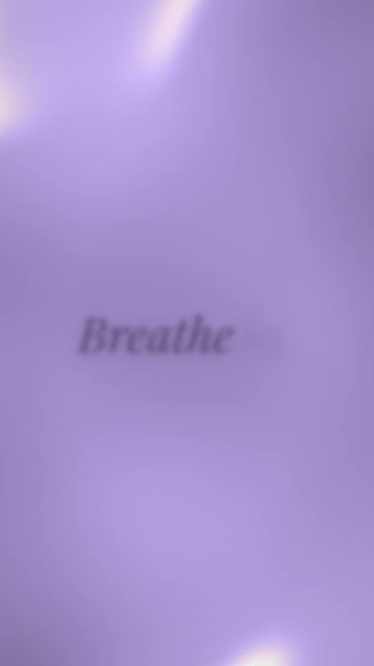 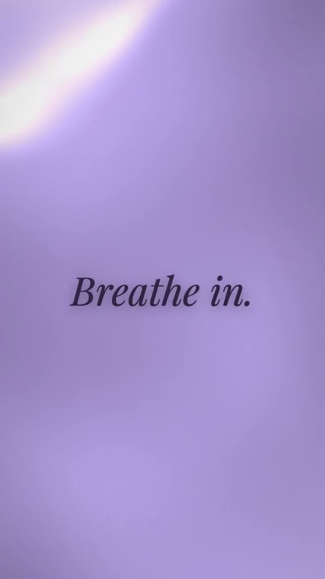

- **Intent:** Hook: calm tactile texture, an invitation.
- **Camera:** Locked; the fabric moves · 100 mm macro feel
- **Light:** Soft top-left key, satin sheen
- **Sound:** Sus2 pad swells in, room-tone air
- **Edit:** Opens already moving — no fade from black

## S02 — MS floating bottle (6 beats, 4.00 s, in: iris)
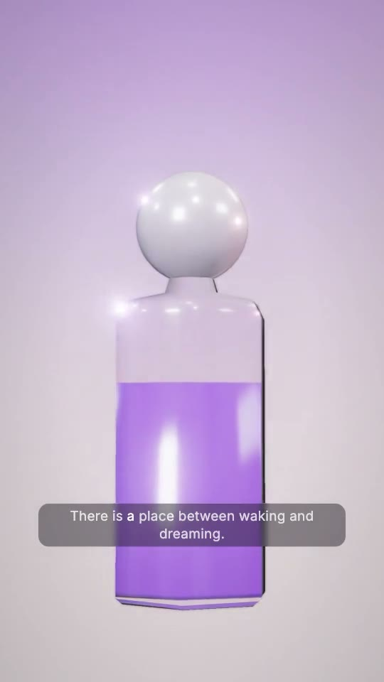 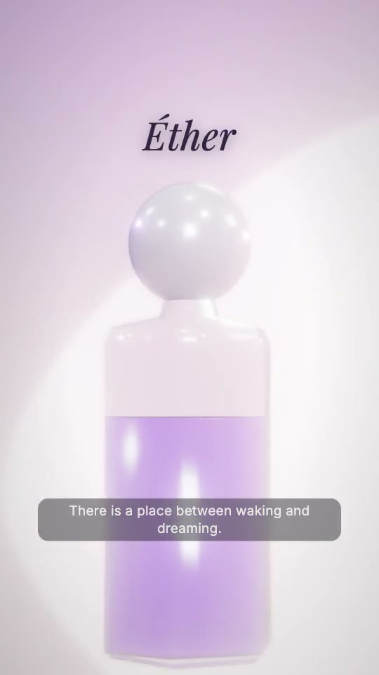

- **Intent:** Meet the object, weightless.
- **Camera:** Slow orbit with gentle crane up · 50 mm
- **Light:** Lavender sky dome, warm key, violet and pink rims
- **Sound:** Pad + first VO line
- **Edit:** Star-iris morph opens out of the silk

## S03 — EWS colonnade over a mirror sea (6 beats, 4.00 s, in: portal)
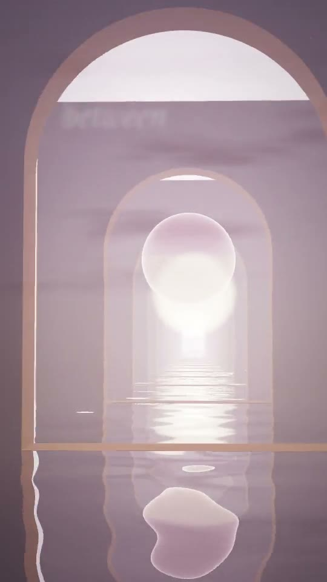 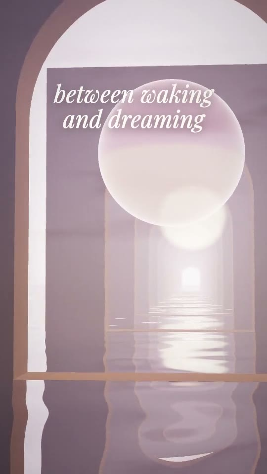

- **Intent:** The place: through the glass into an endless dawn.
- **Camera:** Dead-centre dolly down the corridor through every arch (vertical-native framing), sun rising · 35 mm
- **Light:** Pastel dawn, low sun behind the arches, mirror reflections
- **Sound:** Arps enter; VO 'You can't visit it.'
- **Edit:** Portal: the dreamworld opens from the centre of the bottle

## S04 — Wide, particles (6 beats, 4.00 s, in: zoom)
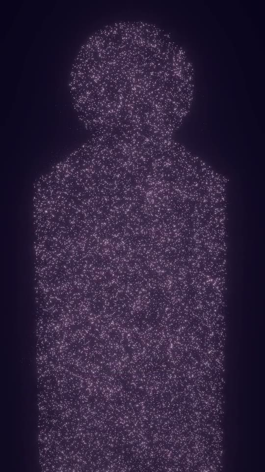 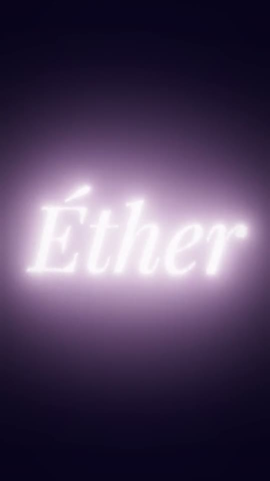

- **Intent:** Memory: the bottle dissolves into a constellation that writes the name.
- **Camera:** Slow orbit · 40 mm
- **Light:** Glowing points on deep violet night
- **Sound:** Riser + shimmer as the name forms
- **Edit:** Zoom-through from the colonnade into the night

## S05 — CU stopper and shoulders (4 beats, 2.67 s, in: iris)
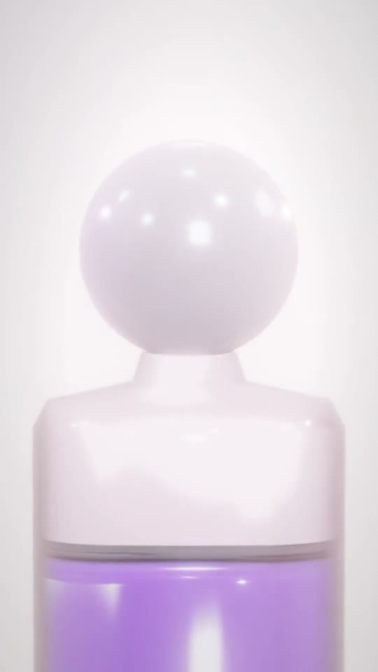 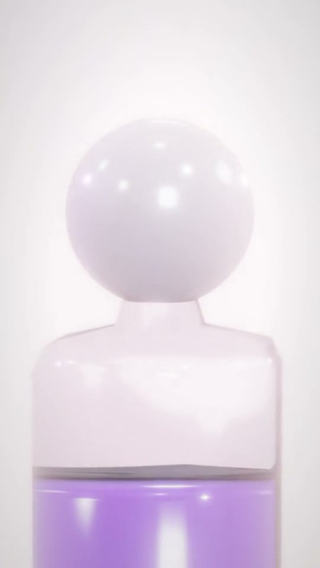

- **Intent:** Detail: the pearl stopper, iridescent.
- **Camera:** Push-in with drift · 85 mm, shallow DOF
- **Light:** Iridescent highlights from the sky dome
- **Sound:** Impact softens into the outro pad
- **Edit:** Iris morph from the constellation

## S06 — Hero + lockup (6 beats, 4.00 s, in: portal)
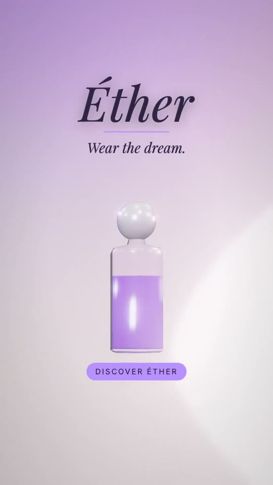 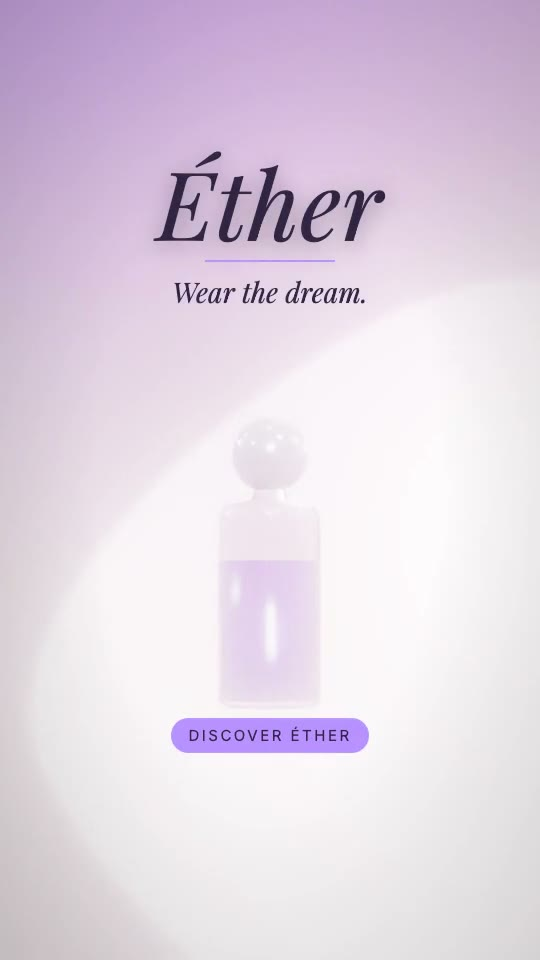

- **Intent:** The place becomes the product.
- **Camera:** Gentle orbit · 50 mm
- **Light:** Dawn sky dome
- **Sound:** Final VO line; pad resolves
- **Edit:** Portal; hold logo 2+ s
