# Storyboard — Social CRM — The Employee That Never Sleeps
Frames rendered from the real production (previs = the film). Contact sheet: `storyboard/contact-sheet.jpg` · 9:16 safe-zone check: `storyboard/mobile-safe-check.jpg` (red = platform UI; no text may sit there).

## S01 — Swarm → macro push-in on a phone (10 beats, 5.00 s, in: cut)
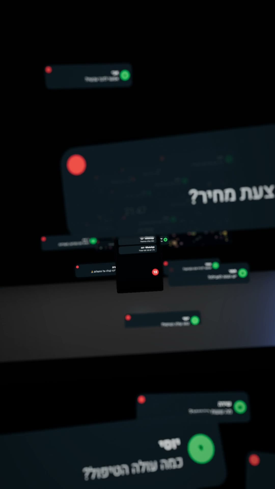 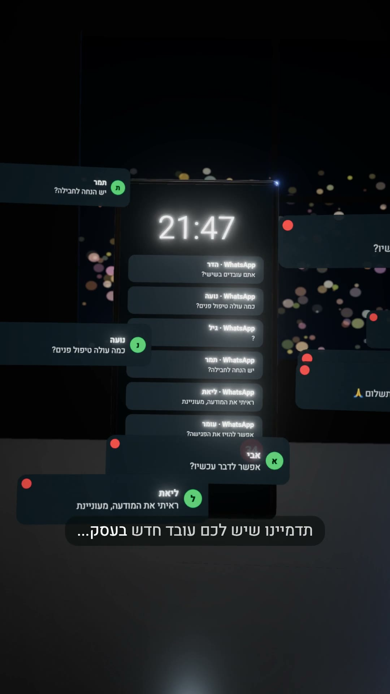

- **Intent:** THE CHAOS — stop the scroll with density and tension.
- **Camera:** Starts inside a storm of message bubbles rushing past the lens; storm parts; aggressive 14→2 unit dolly into the phone with handheld shake and slight roll · 24 mm (wide, aggressive) → 35 mm
- **Light:** Dark luxury office at night: cool rim from the window city-bokeh, phone screen as the key, red notification glints
- **Sound:** Accelerating notification pings stack into a riser, ticking hats, snare roll; VO 'תדמיינו…'
- **Edit:** No cut — one aggressive move; ends on an impact at 5.0 s

## S02 — Convergence → hero object → interface (10 beats, 5.00 s, in: cut)
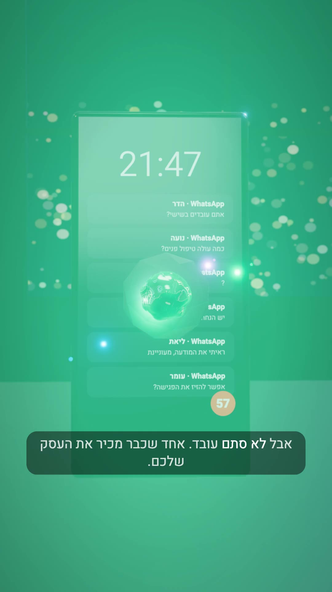 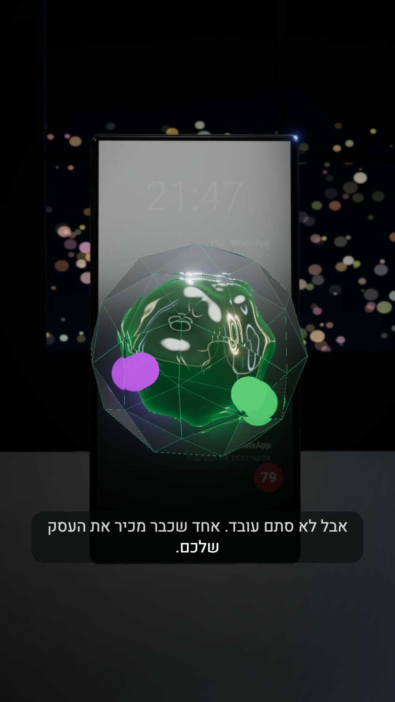

- **Intent:** THE ARRIVAL — all messages converge into one point and the agent is born.
- **Camera:** Locks to centre; slow orbit around the forming core; push into its glass face · 50 mm
- **Light:** Darkness collapses into emerald: the core's inner light becomes the key; chrome reflects a procedural studio
- **Sound:** Reverse-swoosh convergence, impact + flash at birth, pad and arpeggio enter, riser
- **Edit:** Seamless object morph: core → glass shell flattens into the agent interface (match into S03)

## S03A — MCU glass interface slab (5 beats, 2.50 s, in: cut)
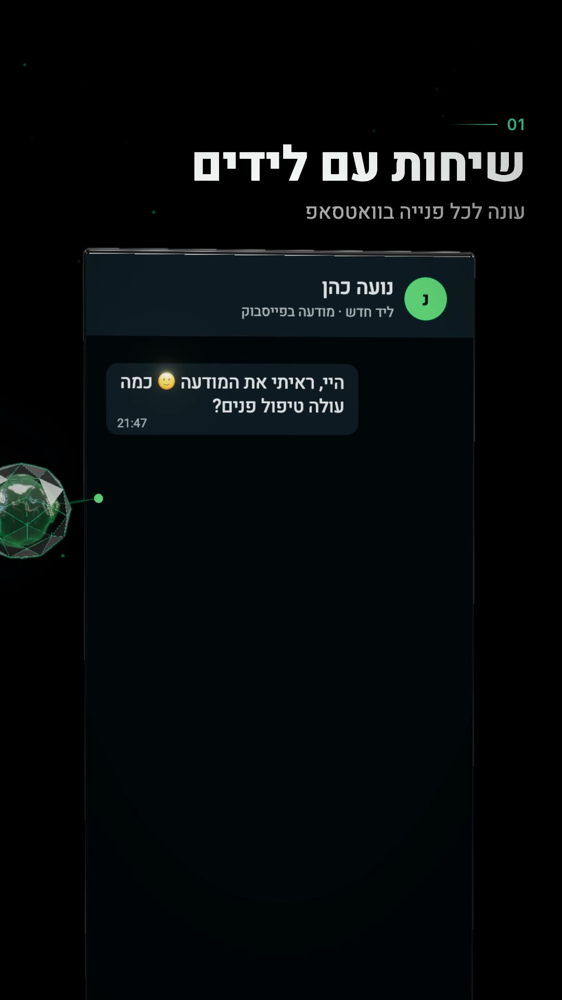 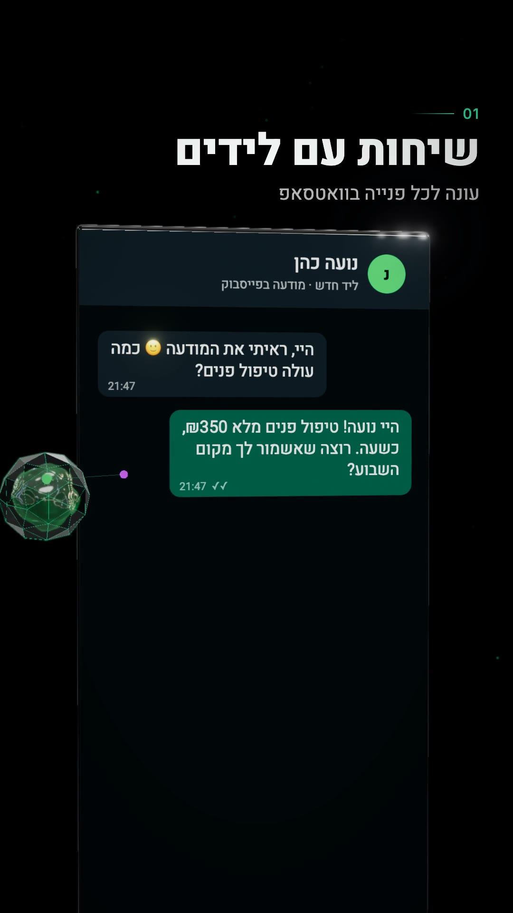

- **Intent:** Conversations: a WhatsApp lead arrives; the agent answers naturally in Hebrew.
- **Camera:** Slow orbit left with push · 50 mm, DOF on the slab
- **Light:** Emerald guide light from the agent orb; cool rim
- **Sound:** Incoming ping, typing clicks, reply ping; VO 'הוא מדבר עם הלידים'
- **Edit:** The agent's reply bubble lifts off and becomes the quote document (object morph)

## S03B — Document forming + owner approval in WhatsApp (5 beats, 2.50 s, in: cut)
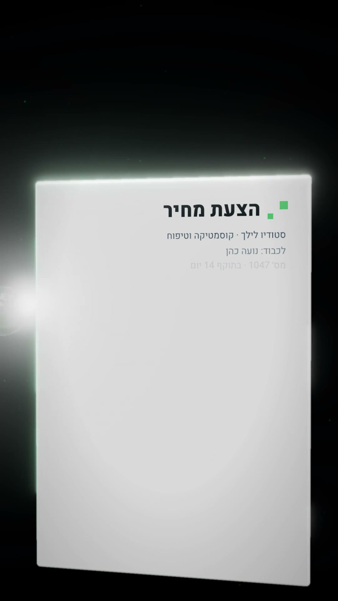 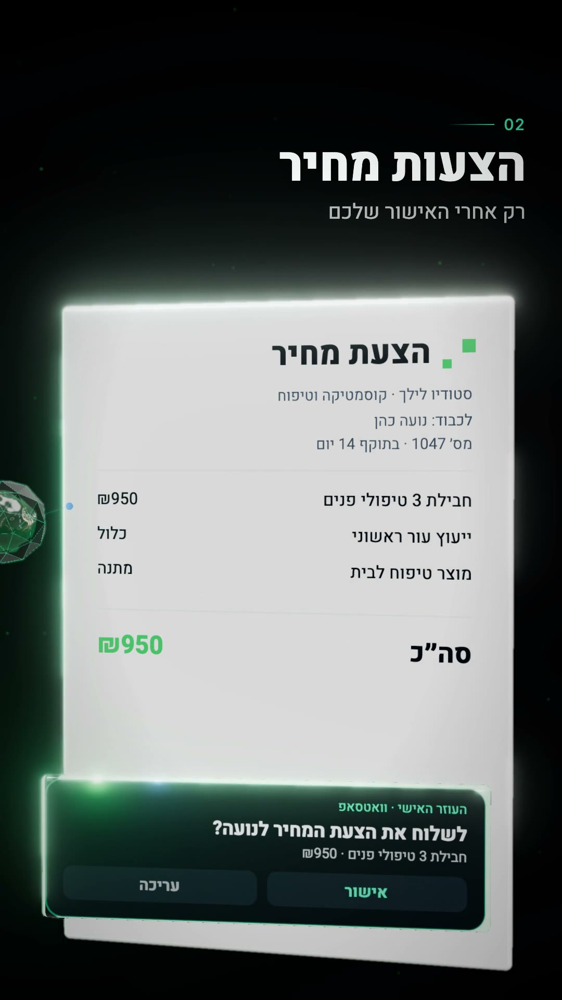

- **Intent:** Quotes: a quotation forms in 3D and is approved by the owner before sending.
- **Camera:** Camera travels along the emerald trail to the document, rises slightly · 50 mm
- **Light:** Paper catches warm-white key; emerald approval glow
- **Sound:** Paper slide, approval chime on 'אישור'; VO 'מכין הצעות מחיר'
- **Edit:** Approved document shrinks and flies into a calendar slot (object morph)

## S03C — Week calendar, one slot rises out of the grid (5 beats, 2.50 s, in: cut)
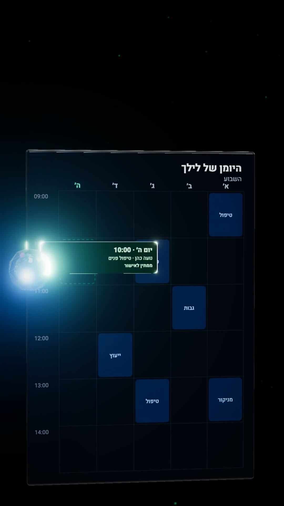 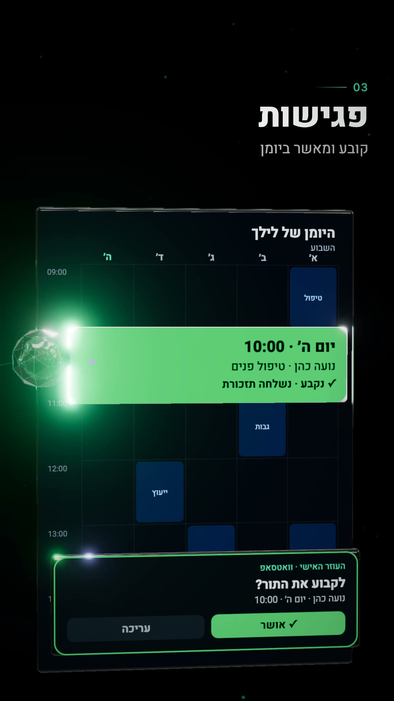

- **Intent:** Meetings: an appointment is created and confirmed.
- **Camera:** Travel + slight dutch correction, settles frontal · 40 mm
- **Light:** Grid self-lit, slot glows emerald
- **Sound:** Tick on slot landing, confirm chime; VO 'קובע פגישות'
- **Edit:** The confirmed slot flips 180° and becomes the receipt header

## S03D — Receipt strip extruding downward (5 beats, 2.50 s, in: cut)
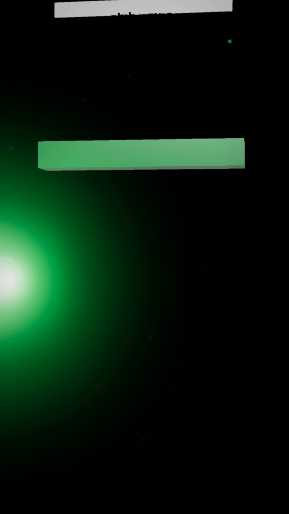 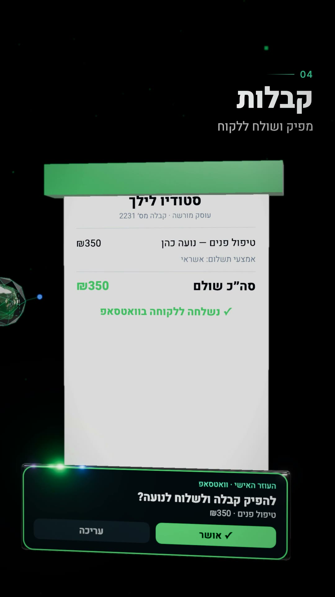

- **Intent:** Receipts: a professional receipt prints.
- **Camera:** Tilt-down following the print · 50 mm
- **Light:** Soft top light on paper, emerald rim
- **Sound:** Print/paper texture, confirm chime; VO 'מפיק קבלות'
- **Edit:** Receipt dissolves into data particles that travel to the next station

## S03E — Field of customer dots → highlighted cluster + insight (6 beats, 3.00 s, in: cut)
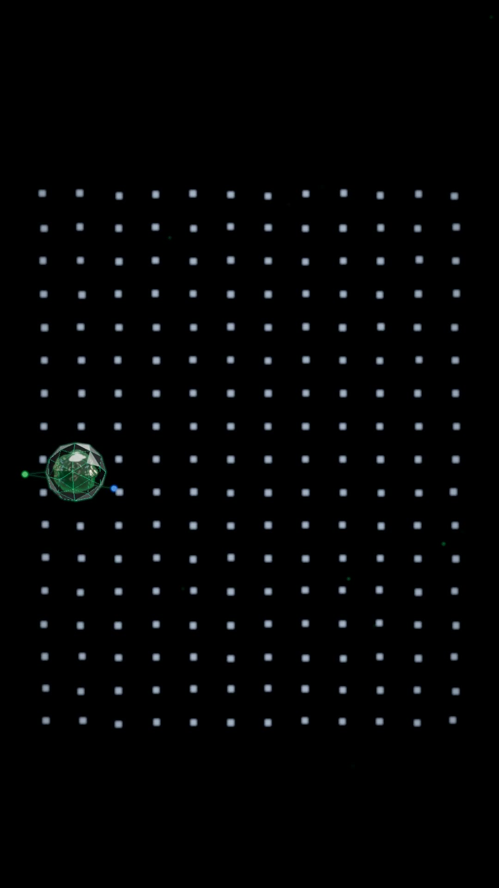 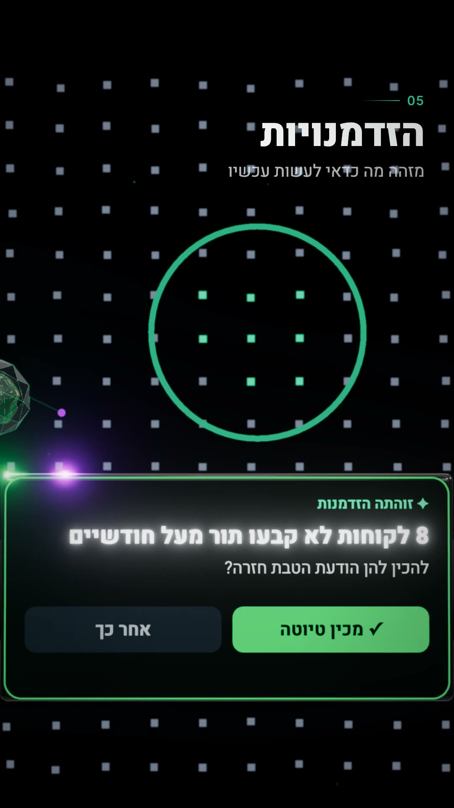

- **Intent:** Opportunities: business data transforms into one highlighted opportunity.
- **Camera:** Pull back to reveal the field, then push to the cluster · 35 mm
- **Light:** Dim data field, highlighted cluster blooms emerald
- **Sound:** Shimmer as the cluster lights; VO 'ומזהה הזדמנויות עסקיות'
- **Edit:** Everything collapses into the phone (match into S04)

## S04 — Phone on a desk; night becomes warm morning daylight; the owner is implied (notebook with a growth plan, coffee, an empty chair turned to the window) (14 beats, 7.00 s, in: cut)
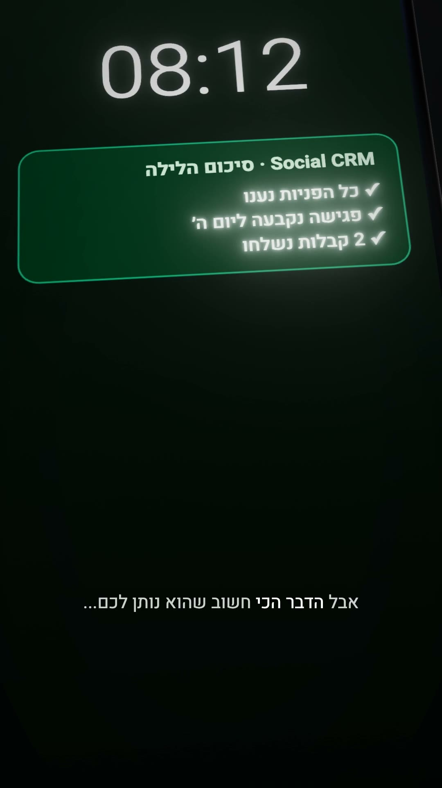 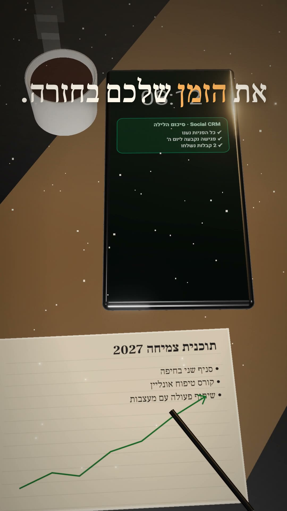

- **Intent:** THE PAYOFF — complexity collapses; silence; time returns.
- **Camera:** Slow, calm dolly along the desk; shallow focus · 50 mm → 85 mm
- **Light:** Dark cool night → warm low sun through the window, volumetric beams, dust in the light
- **Sound:** Music drops to near silence; room tone; a single soft tone; VO 'אבל הדבר הכי חשוב… את הזמן שלכם בחזרה'
- **Edit:** Match cut from the collapse into the phone; the light change IS the transition

## S05 — Hero object → logo icon → wordmark → tagline (10 beats, 5.00 s, in: cut)
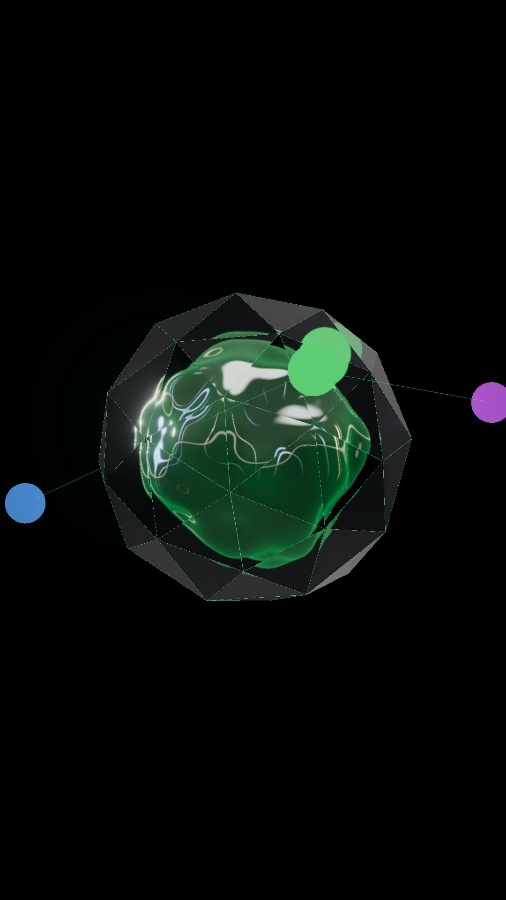 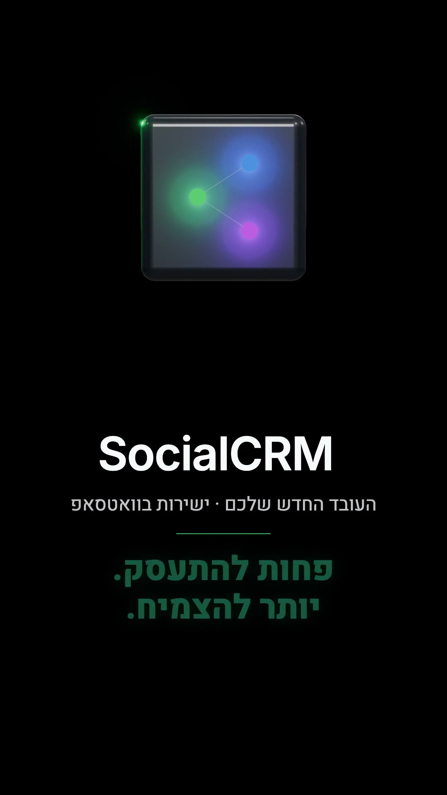

- **Intent:** BRAND REVEAL — the hero becomes the real Social CRM logo.
- **Camera:** Frontal, slow push · 85 mm
- **Light:** Chrome and emerald on black, glint sweep across the icon
- **Sound:** Impact, pad and arpeggio swell, final hit on the tagline; VO brand line
- **Edit:** Seamless morph: nodes take the logo positions, glass shell becomes the rounded-square icon
