# Storyboard — TEMPO — Every Second Has a Beat
Frames rendered from the real production (previs = the film). Contact sheet: `storyboard/contact-sheet.jpg` · 9:16 safe-zone check: `storyboard/mobile-safe-check.jpg` (red = platform UI; no text may sit there).

## S01 — ECU dial centre and red hand (4 beats, 2.00 s, in: cut)
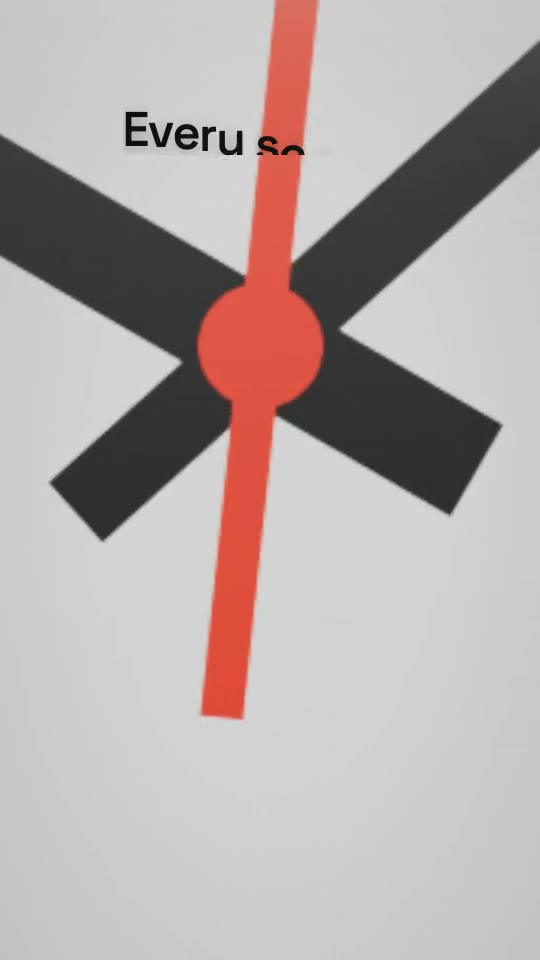 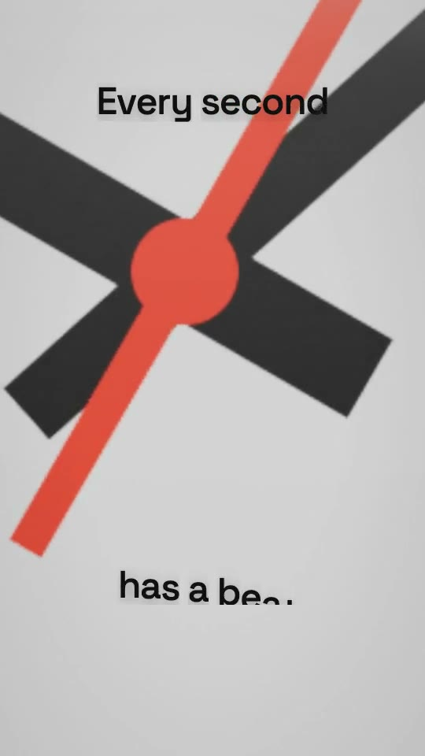

- **Intent:** Hook: the tick, extreme close.
- **Camera:** Imperceptible linear push (a clock doesn't ease) · 85 mm, shallow DOF
- **Light:** Soft white cyc light, specular on the crystal
- **Sound:** Ticks only; VO line
- **Edit:** Opens on a tick; frame 0 shows the red hand

## S02 — Flat Swiss grid (4 beats, 2.00 s, in: cut)
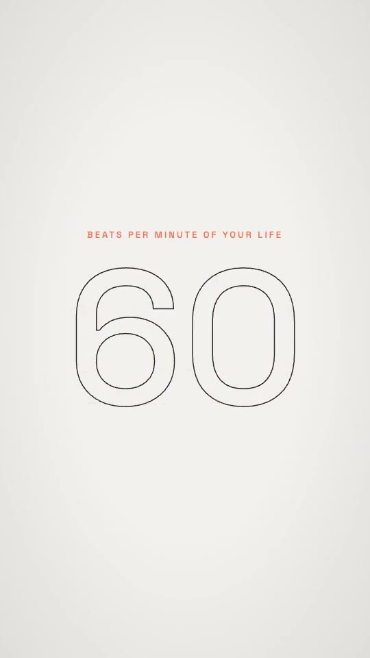 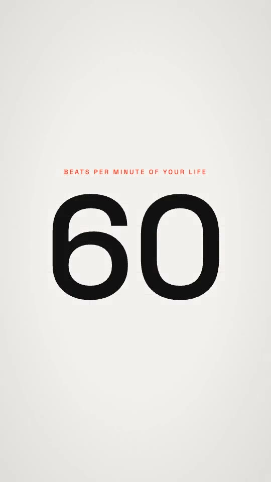

- **Intent:** Scale shift: the second becomes typography.
- **Camera:** Locked · n/a
- **Light:** Flat
- **Sound:** Kick and bass join the tick
- **Edit:** Hard cut on the downbeat; outline fills on beat 2

## S03 — Graphic frames (8 beats, 4.00 s, in: whip)
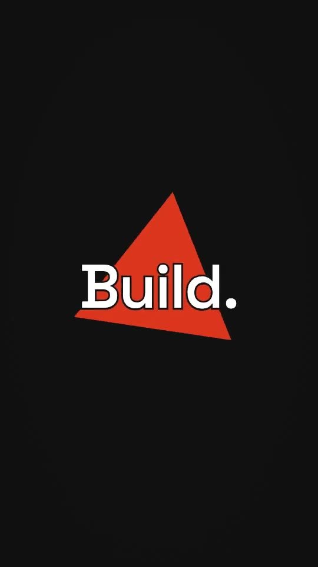 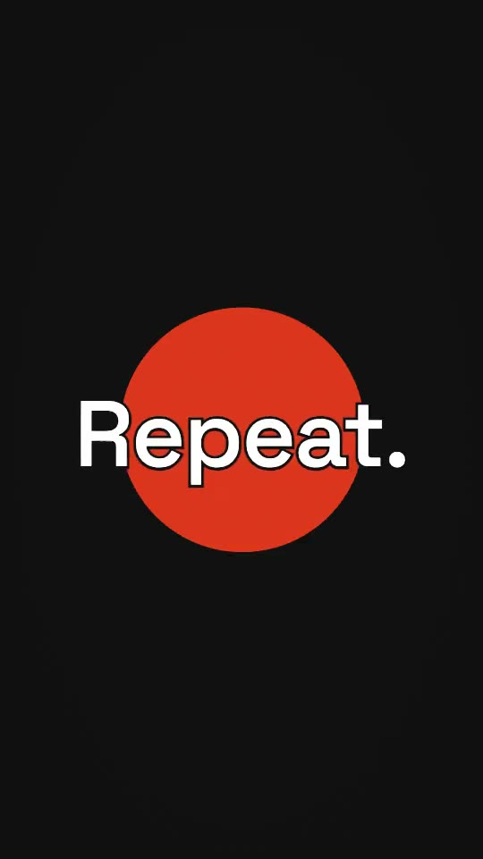

- **Intent:** A life, one second at a time.
- **Camera:** Locked, rotating geometry · n/a
- **Light:** Flat Swiss palette
- **Sound:** Full groove; each cut on a beat
- **Edit:** Whip in, then one cut per beat

## S04 — MCU hero watch (8 beats, 4.00 s, in: iris)
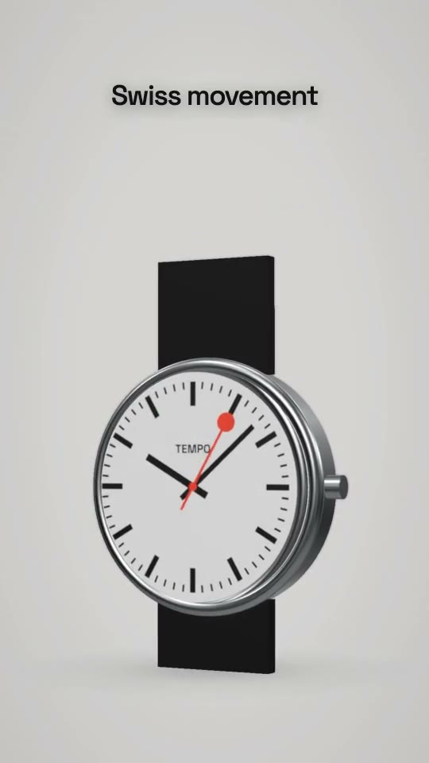 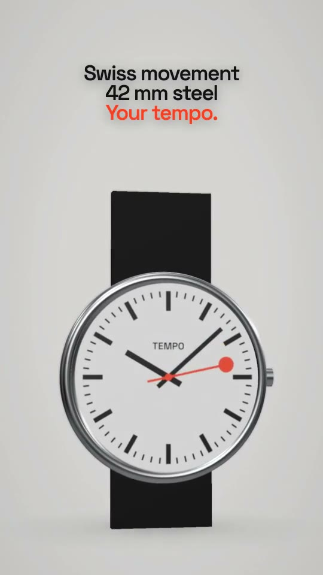

- **Intent:** Reveal the whole object.
- **Camera:** Orbit right-to-left with a slight crane down · 50 mm
- **Light:** White infinity cove, soft key top-left, contact shadow
- **Sound:** Groove + pad
- **Edit:** Iris opens on the downbeat

## S05 — Wide, particles (4 beats, 2.00 s, in: flash)
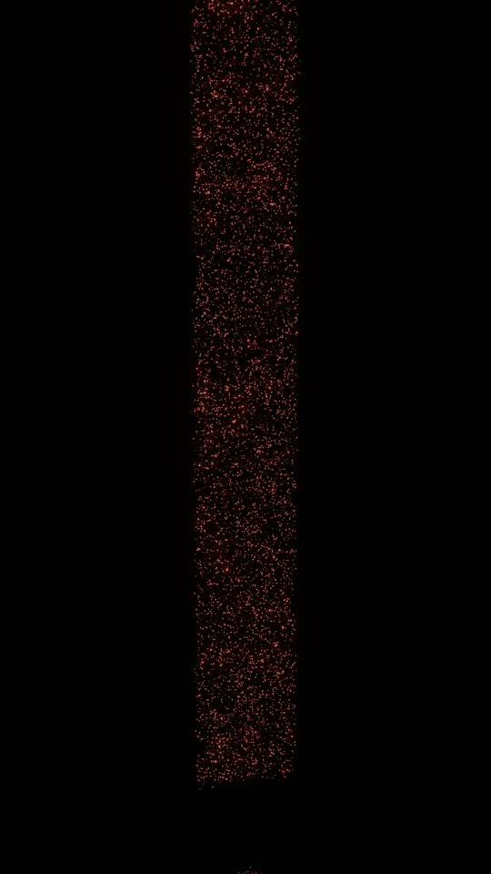 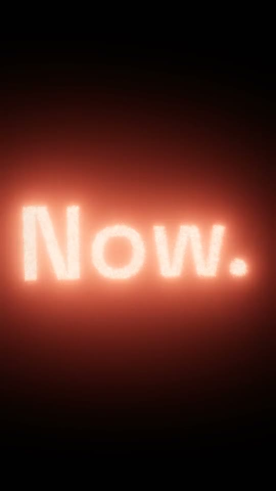

- **Intent:** The turn: in a sudden black void, the second hand melts into 'Now.'
- **Camera:** Slow orbit · 40 mm
- **Light:** Red glow on black — the only dark scene
- **Sound:** Drums drop out; riser
- **Edit:** Flash cut into black = contrast beat

## S06 — Hero + lockup (8 beats, 4.00 s, in: zoom)
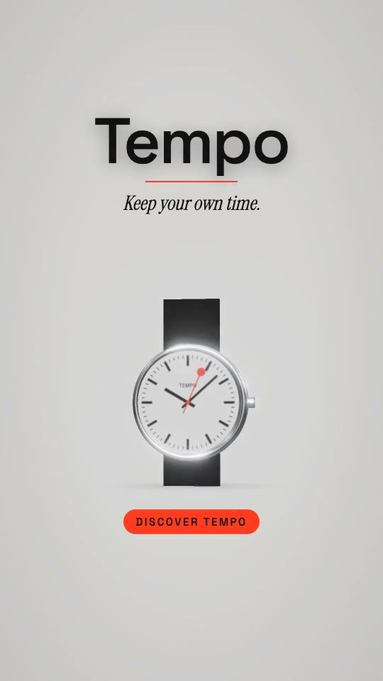 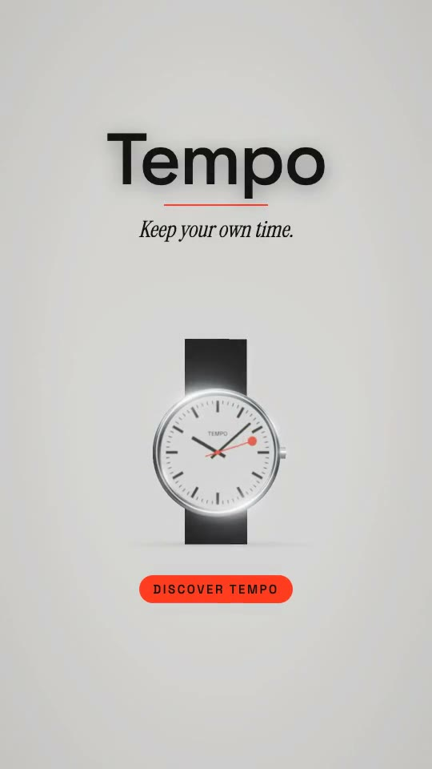

- **Intent:** Back to white; the hand keeps ticking under the logo.
- **Camera:** Slow orbit · 50 mm
- **Light:** White cove
- **Sound:** VO line, ticks and pad, final tick on the last frame
- **Edit:** Zoom-through out of the black
