# Storyboard — VOLT — Crack the Night Open
Frames rendered from the real production (previs = the film). Contact sheet: `storyboard/contact-sheet.jpg` · 9:16 safe-zone check: `storyboard/mobile-safe-check.jpg` (red = platform UI; no text may sit there).

## S01 — ECU ring-pull (4 beats, 1.60 s, in: cut)
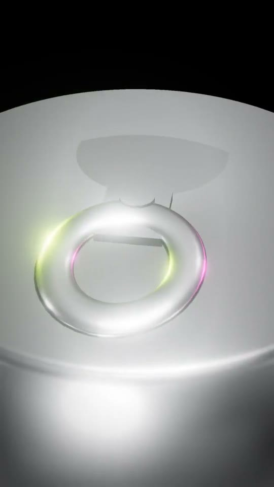 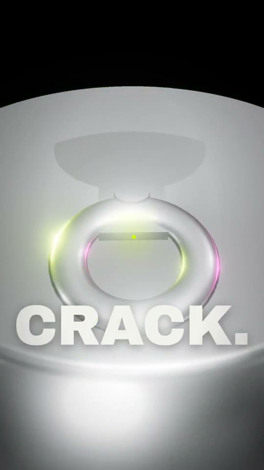

- **Intent:** Hook: mystery macro, then the crack.
- **Camera:** Slow push-in and drift over the lid, DOF on the tab · 85 mm macro feel
- **Light:** Void stage: only lime (left) and magenta (right) rims skim the aluminium from behind; no key light — the metal is drawn by its edges
- **Sound:** Riser builds, HIT + glitch on the crack
- **Edit:** Cut on the crack; frame 0 already shows the glinting lid

## S02 — POV forward through a tunnel (8 beats, 3.20 s, in: portal)
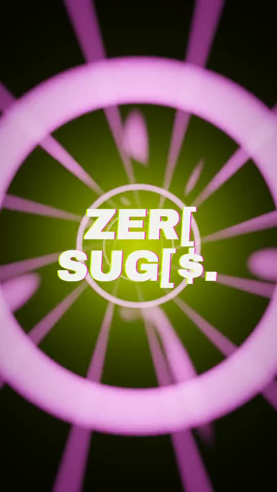 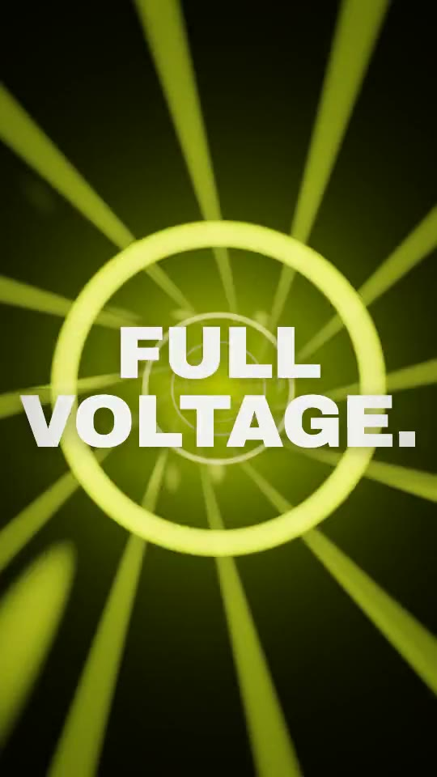

- **Intent:** Through the opening into pure energy — escalation.
- **Camera:** Accelerating fly-through with increasing twist · Wide 24 mm feel
- **Light:** Self-lit voltage rings, core flashes on every kick
- **Sound:** Drop: kick, bass, 16th hats; tunnel core pulses on kicks
- **Edit:** Portal iris opens out of the can's dark lid

## S03 — Wide, particles fill the frame (8 beats, 3.20 s, in: glitch)
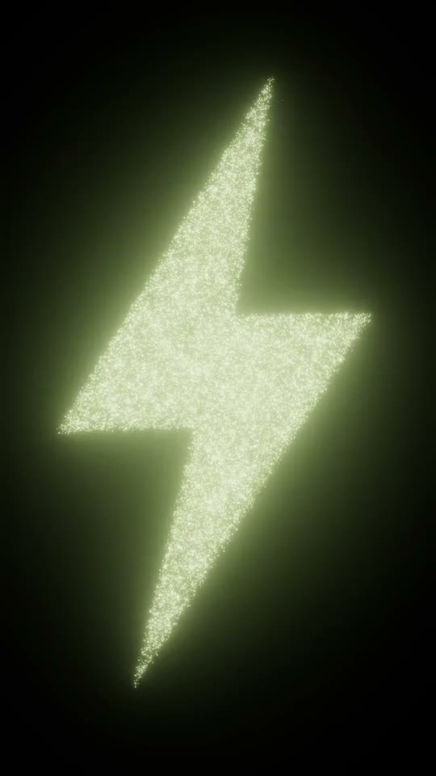 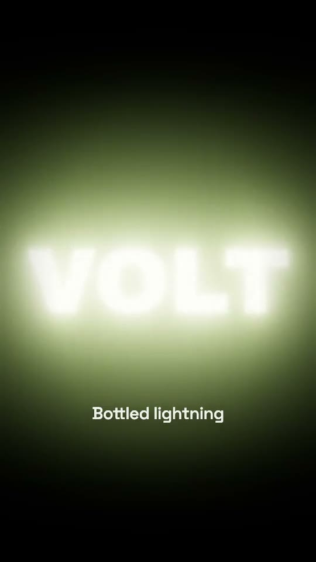

- **Intent:** Transformation: a lightning bolt melts and re-forms into the name.
- **Camera:** Slow orbit around the particle field · 40 mm
- **Light:** Additive glow, bloom
- **Sound:** Build: arps + snare roll + riser into the drop
- **Edit:** Glitch cut in; the name detonates on beat 7 (flash + shockwave + burst) and the montage cuts in on the drop

## S04 — Flat graphic frames (8 beats, 3.20 s, in: flash)
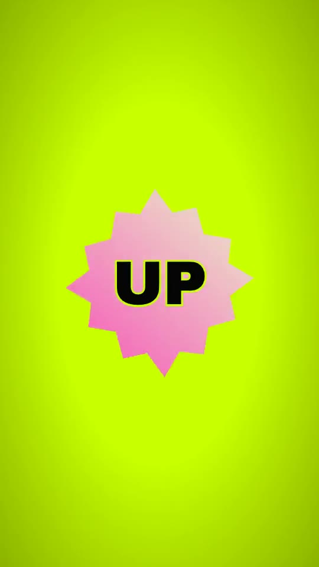 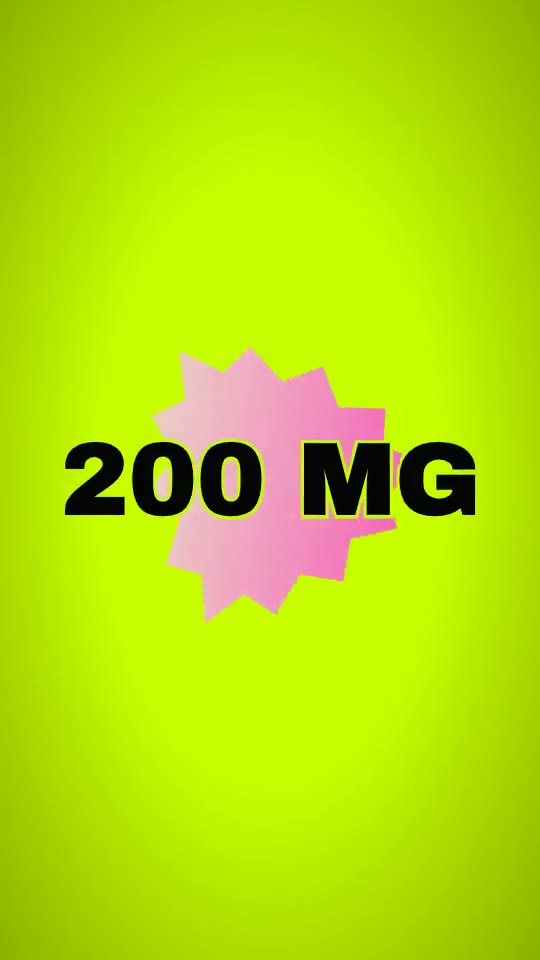

- **Intent:** Rhythm: claims delivered one per beat.
- **Camera:** Locked; shapes rotate · n/a (2D)
- **Light:** Flat neon palette swaps
- **Sound:** Drop: every cut on a kick
- **Edit:** Hard cut every beat (12 frames), velocity kept by rotating shape

## S05 — Low-angle hero, MS → MCU (12 beats, 4.80 s, in: zoom)
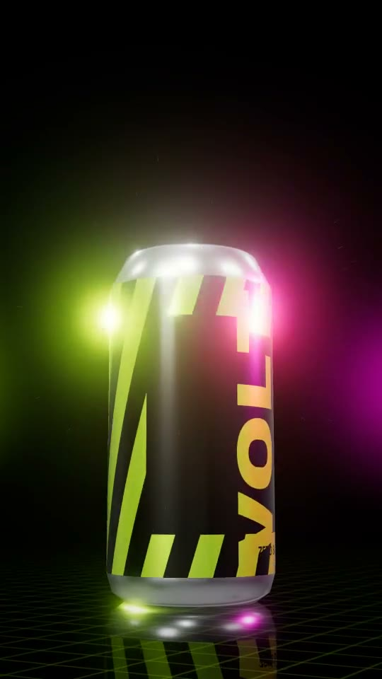 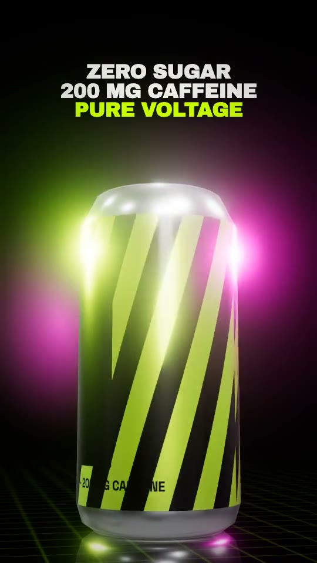

- **Intent:** The product lands like a meteor — hero.
- **Camera:** Orbit right-to-left while pushing in · 35 mm, low and heroic
- **Light:** Lime + magenta rims, white top key, mirrored grid floor
- **Sound:** Sub drop + hit on landing; full drop
- **Edit:** Zoom-through in, the can falls into frame on beat 1

## S06 — Logo over spinning can (8 beats, 3.20 s, in: flash)
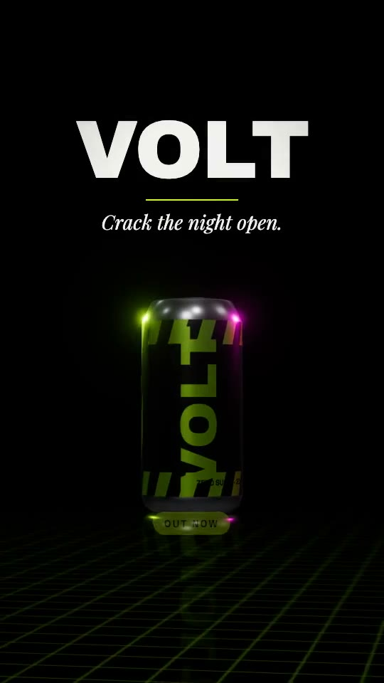 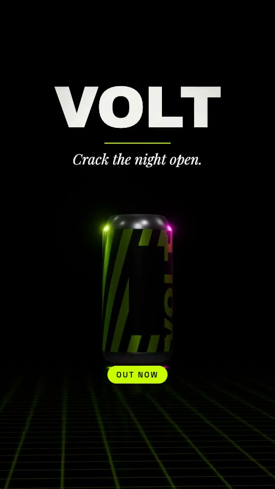

- **Intent:** Lockup + button callback.
- **Camera:** Gentle orbit · 50 mm
- **Light:** Neon stage
- **Sound:** Impact, pad, VO line, final spark hit
- **Edit:** Flash cut; hold logo ≥ 2 s; final spark on the last beat
